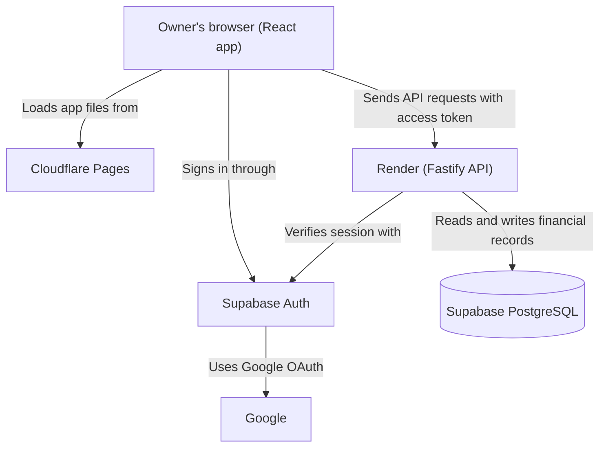

# FinScope architecture

[ADR 0001](adr/0001-initial-mvp-stack.md) records the initial stack and deployment decisions. The current runtime is Node.js 26 with pnpm 11.3.0, as pinned in [.node-version](../.node-version), the [workspace manifest](../package.json), and the [Dockerfile](../Dockerfile). The repository now contains Vitest and browser checks. [Testing and verification](standards/testing.md)

## Runtime and boundaries

| Boundary | Responsibility |
| --- | --- |
| [Web app](../apps/web/src/main.tsx) | Vite builds a React single-page app for Cloudflare Pages. TanStack Router selects the workspace view, TanStack Query owns cached server data, and forms use React Hook Form and Zod. Keep reusable controls with the [UI primitives](../apps/web/src/components/ui) and theme tokens in [the stylesheet](../apps/web/src/index.css). |
| [API](../apps/api/src/index.ts) | The containerised Fastify process on Render wires authorization, repositories, and PostgreSQL into the HTTP app. Domain routes validate requests and call the repositories and accounting code. The API reports readiness at `/health` and uses Pino for request logs and Sentry for unexpected errors. [API assembly](../apps/api/src/app.ts) · [Deployment](deployment.md) |
| [Shared contracts](../packages/contracts/package.json) | The web app and API consume shared Zod schemas. Keep HTTP contract changes aligned across both callers and the [OpenAPI document](openapi.json). |
| [PostgreSQL](../apps/api/drizzle) | Supabase hosts the financial tables in `finscope_private`. Drizzle runs migrations under a database lock before the API starts listening. [Migration entry point](../apps/api/src/database.ts) · [Local PostgreSQL configuration](../compose.yaml) |

The browser signs in with Google through Supabase Auth and sends its access token to the API. The API looks up the authenticated user and checks the configured Supabase user UUID and Google subject before granting financial access. Keep `finscope_private` outside the Supabase Data API's exposed schemas. The [deployment runbook](deployment.md) covers provider configuration, secrets, backup, and recovery. [Browser auth](../apps/web/src/auth.ts) · [API owner authorization](../apps/api/src/financial-accounts/authorization.ts)

## Financial records and invariants

- A financial account belongs to the owner and starts with a dated opening balance. Everyday transactions reference one account. A transfer references both accounts and appears in both histories while leaving everyday income and expenses unchanged. [Account repository](../apps/api/src/financial-accounts/repository.ts) · [Transfer repository](../apps/api/src/transfers/repository.ts) · [Cashflow summary](../apps/api/src/financial-accounts/summary.ts)
- An ETF trade belongs to a brokerage account. Trades update cash, units, and running weighted-average cost with decimal arithmetic. A correction must preserve valid cash funding and units for affected later trades. Missing market prices leave open holdings unpriced. [ETF accounting](../apps/api/src/etf-trades/accounting.ts) · [ETF repository](../apps/api/src/etf-trades/repository.ts)
- Storage constraints protect ownership and opening dates. Transactions and an owner-scoped advisory lock coordinate competing changes that affect recorded activity. Deleting an everyday transaction, transfer, or ETF trade writes a retained deletion record in the same transaction. [Migrations](../apps/api/drizzle) · [Activity lock](../apps/api/src/financial-accounts/activity-lock.ts) · [Deletion records](../apps/api/src/audit/activity-deletions.ts)

Use the [glossary](../GLOSSARY.md) for project terms and the [product requirements](product-requirements.md) for future capabilities. The [playbook index](standards/playbook/README.md) routes boundary, contract, and data changes to the applicable standards.
