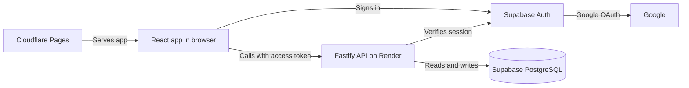

# FinScope architecture

FinScope is a React web app backed by a Fastify modular monolith and PostgreSQL. [Stack and deployment decisions](adr/0001-initial-mvp-stack.md)

## Runtime and boundaries

- The API checks both the configured Supabase user ID and Google subject before granting workspace access. Keep the `finscope_private` schema outside the Supabase Data API's exposed schemas. [Owner authorization](../apps/api/src/infrastructure/supabase-owner-auth.ts) · [Deployment runbook](deployment.md)
- The API applies Drizzle migrations before listening. Public `/health` checks database readiness. [API startup](../apps/api/src/index.ts) · [Migrations](../apps/api/drizzle)
- The web app and API share Zod schemas. Keep HTTP contract changes aligned with OpenAPI. [Shared contracts](../packages/contracts) · [OpenAPI](openapi.json)

## Backend module ownership

API composition wires services to repositories. The workspace plugin authorizes the owner and sets `Cache-Control: no-store` before request validation and feature handlers run. [API composition](../apps/api/src/app/compose.ts) · [Workspace plugin](../apps/api/src/app/workspace.plugin.ts)

| Request flow | Responsibility |
| --- | --- |
| `*.schema.ts` and `*.routes.ts` | Define request validation from shared schemas, register endpoints, and translate use-case results into HTTP responses. |
| `*.service.ts` | Make use-case decisions, including checks that depend on stored records. |
| `*.repository.ts` | Own SQL, owner scoping, and transactions. For writes, the repository passes transaction-bound operations to the service callback. |

Features own routes by what they do. For example, Transactions owns the account history endpoint and ETF Trades owns the holdings endpoint, even though both URLs sit under `/financial-accounts`.

| Module | Owns |
| --- | --- |
| [Financial Accounts](../apps/api/src/financial-accounts) | Account management and reporting summaries. |
| [Transactions](../apps/api/src/transactions) | Everyday transaction writes and the combined transaction and transfer history. |
| [Transfers](../apps/api/src/transfers) | Transfers between financial accounts. |
| [ETF Trades](../apps/api/src/etf-trades) | ETF trades, holdings, and portfolio valuation. |
| [Account Activity](../apps/api/src/account-activity) | Shared cash queries, saved-trade funding checks, and the owner-scoped write lock. |

## Frontend module ownership

- The app owns routing, session, and providers. The workspace coordinates features and scopes TanStack Query's cache entries to the signed-in user. [App](../apps/web/src/app) · [Workspace](../apps/web/src/app/routes/workspace.tsx)
- Features keep their UI, validation, and HTTP calls together. Financial Accounts manages accounts, Cash Activity handles transactions and transfers, Investments handles ETF trades and holdings, and Overview displays reporting and valuation data supplied by the workspace. [Features](../apps/web/src/features)
- Shared code holds reusable UI and utilities. Global styles own theme tokens, and feature-specific styles live with their views. [Shared code](../apps/web/src/shared) · [Global styles](../apps/web/src/app/styles/globals.css)

## Financial records and invariants

- A financial account has a dated opening balance. Activity must respect the account's opening date. Transfers appear in both accounts' histories and are excluded from everyday income and expenses. [Migrations](../apps/api/drizzle) · [Cashflow summary](../apps/api/src/financial-accounts/summary.ts)
- ETF trades belong to brokerage accounts. Corrections must preserve cash funding and available units for affected later trades. Holdings use weighted-average cost and remain unpriced when a market price is missing. [Trade funding](../apps/api/src/account-activity/trade-funding.service.ts) · [ETF accounting](../apps/api/src/etf-trades/accounting.ts)
- Activity writes use an owner-scoped PostgreSQL advisory lock. Keep write checks and the change in the same transaction. Deleting a transaction, transfer, or ETF trade also writes a retained deletion record in that transaction. [Activity lock](../apps/api/src/account-activity/activity-lock.ts) · [Deletion records](../apps/api/src/audit/activity-deletions.ts)

[Glossary](../GLOSSARY.md) · [Product requirements](product-requirements.md) · [Testing and verification](standards/testing.md) · [Engineering standards](standards/playbook/README.md)
